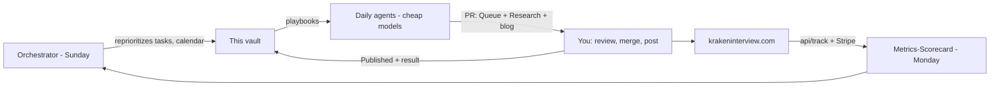

# Kraken Interview — Marketing HQ

This vault is the single source of truth for growing Kraken Interview from 0 users to a paying subscriber base with **zero paid budget**. Agents read it, write to it, and open PRs; you approve and post. Start every session here.

> Open this folder (`docs/marketing-vault`) as a vault in Obsidian. Everything is plain Markdown with wikilinks; no community plugins required.

## Scoreboard (updated weekly by [[Metrics-Scorecard]])

| Metric | Baseline (2026-09-10) | Last week | Month-1 target |
|--------|-----------------------|-----------|----------------|
| Trial starts / week | 0 | - | 125 |
| Purchases / week | 0 | - | 6-12 |
| Trial to paid % | - | - | 5-10% |
| MRR | $0 | - | $2,500 |
| Site sessions / week | ~0 | - | 1,250 |

Latest scorecard: [[Week-2026-W37]]. History in `07-Metrics/`.

## Needs your decision / action (curated by [[Orchestrator]])

- [ ] **Record Clip 1 (split-screen "what you see vs what they see")** — see [[Demo-Shot-List]]. Nothing else in this vault matters as much. → [[T-001 Record demo Clip 1 split-screen]]
- [ ] Set `EVENTS_READ_TOKEN` secret in Cloudflare Pages so the scorecard agent can read `/api/track/summary` → [[T-004 Set EVENTS_READ_TOKEN and verify track endpoint]]
- [ ] Run `create-promo-codes.ts` with the live Stripe key so `REDDIT10` / `TWITTER10` / `FRIEND10` / `CREATOR10` resolve at checkout → [[T-005 Create live Stripe promotion codes]]
- [ ] Submit sitemap to Google Search Console and Bing Webmaster → [[T-006 Submit sitemap to GSC and Bing]]
- [ ] Connect the GitHub repo to Cursor cloud agents so the six automations can run → [[T-007 Connect repo to Cursor Automations]]
- [ ] Review today's queue: `05-Content/Queue/` → move to `Approved/`, post, then to `Published/` with the result.

## This week (see [[Content-Calendar]])

Week of 2026-09-14 — theme: **Proof**. Ship the demo clip, post it natively on X / Shorts / TikTok / Reddit, and get the first 20 trial starts.

## Map of content

### Strategy — why and for whom
- [[Positioning]] — dual front doors: `/` (organic, stealth angle) vs `/practice` (ad-safe)
- [[ICP-Personas]] — Loop Engineer, New Grad, Career Switcher
- [[Funnel-and-Metrics]] — Discover → Download → Trial → Pay → Refer; targets and definitions
- [[Roadmap-90-Day]] — Proof (weeks 1-4) → Distribution (5-8) → Compounding (9-12)
- [[Compliance-and-Ethics]] — disclosure, no fake proof, platform policies. Binding for every agent.
- [[Relaunch-Plan]] — the post-mortem on why v1 got 0 users
- [[Growth-Playbook]] — original channel playbook (superseded where this vault disagrees)
- Competitors: [[Interview-Coder]] · [[ShadeCoder]] · [[LockedIn-AI]] · [[Final-Round-AI]] · [[Cluely]]

### Channels — where
[[SEO-Blog]] · [[Reddit]] · [[X]] · [[Discord]] · [[YouTube-Shorts-TikTok]] · [[Product-Hunt]] · [[Hacker-News]] · [[Micro-Influencers-Affiliates]] · [[Email]]

### Campaigns — time-boxed pushes
[[Demo-Clip-Launch]] · [[Product-Hunt-Launch]] · [[Alternative-Pages-SEO]] · [[Referral-Creators]]

### Execution
- [[Kanban]] — all tasks by status; task notes live in `04-Tasks/`
- [[Content-Calendar]] — 4-week rolling plan; drafts land in `05-Content/Queue/`
- Research: [[Keyword-Backlog]] · [[Subreddit-Rules]] · [[Communities]] · [[Competitor-Changes]] · [[Demo-Shot-List]] · daily digests in `06-Research/Community-Watch/`
- Metrics: `07-Metrics/` weekly scorecards

### Agents — who does the routine work
- [[Conventions]] — rules every agent follows (branches, PRs, frontmatter, what never to touch)
- [[Orchestrator]] — weekly review, re-prioritization, decisions for you
- [[Social-Drafter]] (daily) · [[Community-Scout]] (daily) · [[SEO-Blog-Writer]] (Mon/Thu) · [[Competitor-Watch]] (Fri) · [[Metrics-Scorecard]] (Mon)
- Daily run logs in `09-Daily-Logs/`

## How the loop works

## Operating principles
1. **Proof beats copy.** A 12-second split-screen clip converts better than any landing page rewrite.
2. **Fear-state search is the buying moment.** Rank for "failed system design interview", not "AI tools".
3. **Value first, disclosure always.** Every community post teaches something and says who we are.
4. **One PR per agent run.** Small, reviewable, reversible.
5. **Never fabricate.** No fake testimonials, reviews, numbers, or accounts. Ever.
