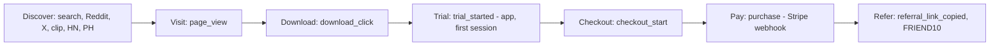

# Funnel and metrics

## Funnel

## North star
**Trial starts per week** (`trial_started`, recorded server-side when a device consumes its first free-trial session). It is the first event that proves the product was actually opened on a real machine, and it is upstream of revenue by only one step. Everything the agents do should be traceable to more trial starts or a higher trial-to-paid rate.

## Definitions and where the numbers come from

| Metric | Event / source | Notes |
|--------|----------------|-------|
| Page views | `page_view` via `/api/track` (+ GA4 if `VITE_GA_MEASUREMENT_ID` set) | Counted per `utm_source`; direct if none |
| Download clicks | `download_click` (`platform` = win/mac) | Fired from `DownloadLink.tsx` |
| Trial starts | `trial_started` (`source` = app) | `functions/lib/freeTrial.ts` on first consume |
| Checkout starts | `checkout_start` (`plan_id`, `promo_code`) | `PricingCard.tsx` |
| Purchases | `purchase` (`source` = plan id) | Stripe webhook `checkout.session.completed` |
| MRR, active subs, churn | Stripe Dashboard / Stripe MCP | Source of truth for money |
| Referral copies | `referral_link_copied` | `/referral` page |

Read everything at once: `GET https://krakeninterview.com/api/track/summary?days=7` with `Authorization: Bearer <EVENTS_READ_TOKEN>`.

## Targets

| Metric | Month 1 (by 2026-10-10) | Month 2 | Month 3 |
|--------|-------------------------|---------|---------|
| Sessions / week | 1,250 | 3,000 | 6,000 |
| Download clicks / week | 250 | 600 | 1,200 |
| Trial starts / week | 125 | 300 | 600 |
| Trial to paid | 5% | 7% | 8% |
| Purchases / week | 6 | 21 | 48 |
| MRR | $2,500 | $6,000 | $12,000 |
| Real testimonials | 5 | 15 | 30 |

Assumptions: visit-to-download 20% (high-intent traffic, proof clip above the fold), download-to-trial 50% (installer friction, SmartScreen reputation), blended ARPU ~$60 first payment. If visit-to-download is below 10% after the clip ships, the problem is the landing page, not traffic — stop adding channels and fix conversion.

## Weekly rhythm
- **Monday** — [[Metrics-Scorecard]] writes `07-Metrics/Week-YYYY-Www.md` from `/api/track/summary` + Stripe. Home scoreboard updated.
- **Daily** — [[Social-Drafter]] and [[Community-Scout]] fill `05-Content/Queue/` and `06-Research/Community-Watch/`. You approve and post; record `result` in the note when you have it.
- **Sunday** — [[Orchestrator]] reads the week, kills what did not work, doubles what did, rewrites [[Content-Calendar]], updates "Needs your decision" on [[00-Home]].

## Attribution rules
- Every link we post carries `utm_source`, `utm_medium`, `utm_campaign` per [[Conventions#UTM and promo codes]].
- Promo codes double as attribution at checkout: `REDDIT10`, `TWITTER10`, `PHUNT10`, `DISCORD10`, `FRIEND10`, `CREATOR10`, default `LAUNCH10`.
- Referrer fallback: `/api/track` records `ref-<host>` when no UTM is present (catches Reddit/HN/X clicks where the UTM was stripped).

## Kill / scale rules (the Orchestrator applies these)
- A channel with 3 consecutive weeks of >0 posts and 0 trial starts attributed → pause it, write the reason in the channel note.
- A post format that produced a trial start → make 3 variants next week.
- Any blog post that gets an impression in GSC for a "fear" query within 4 weeks → write the two adjacent queries from [[Keyword-Backlog]].
